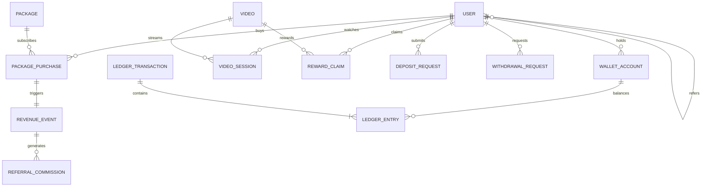

# VistaraX Database Schema & Financial Ledger Design

## 1. Relational Entity Overview

The VistaraX data model balances relational integrity, auditability, double-entry financial accounting, and content access gating.

---

## 2. Table Specifications

### 2.1 `User`
- `id` (String UUID, PK): Unique identifier.
- `email` (String, Unique): Verified email address.
- `passwordHash` (String): Salted bcrypt hash.
- `fullName` (String): Legal / display name.
- `phone` (String, Optional): Contact number.
- `role` (String, Indexed): `SUPER_ADMIN`, `FINANCE_ADMIN`, `CONTENT_ADMIN`, `SUPPORT_AGENT`, `USER`.
- `status` (String, Indexed): `ACTIVE`, `SUSPENDED`, `PENDING_VERIFICATION`.
- `emailVerified` (Boolean): Verification state.
- `referralCode` (String, Unique): Generated unique referral code (e.g. `VX-AB12CD`).
- `referredById` (String, Optional, FK -> `User.id`): Lineage link to referrer.
- `createdAt`, `updatedAt` (DateTime).

### 2.2 `WalletAccount` & Double-Entry Ledger
To eliminate floating-point imprecision and race conditions:
- **`WalletAccount`**:
  - `id` (String UUID, PK)
  - `userId` (String, Optional, FK -> `User.id`): Null for system clearing accounts.
  - `accountType` (String): `USER_AVAILABLE`, `USER_RESERVED`, `SYSTEM_CASH_EASYPAISA`, `SYSTEM_CASH_JAZZCASH`, `SYSTEM_CASH_CRYPTO`, `SYSTEM_REVENUE_PACKAGES`, `SYSTEM_EXPENSE_REWARDS`, `SYSTEM_EXPENSE_REFERRALS`.
  - `currency` (String): `USD` or `PKR`.
  - `balanceCents` (Int): Minor units (e.g., $10.00 is stored as 1000 cents).
  - Unique Constraint: `(userId, accountType, currency)`.
- **`LedgerTransaction`**:
  - `id` (String UUID, PK)
  - `reference` (String, Unique): Idempotency key and business reference.
  - `transactionType` (String): `DEPOSIT`, `WITHDRAWAL_HOLD`, `WITHDRAWAL_SETTLE`, `WITHDRAWAL_RELEASE`, `PACKAGE_PURCHASE`, `REWARD_CREDIT`, `REFERRAL_COMMISSION`, `ADJUSTMENT`.
  - `currency` (String): Currency code.
  - `description` (String): Human-readable audit narrative.
  - `postedById` (String, Optional): Admin or System poster ID.
  - `createdAt` (DateTime).
- **`LedgerEntry`**:
  - `id` (String UUID, PK)
  - `transactionId` (String, FK -> `LedgerTransaction.id`)
  - `accountId` (String, FK -> `WalletAccount.id`)
  - `entryType` (String): `DEBIT` or `CREDIT`.
  - `amountCents` (Int): Positive integer in minor currency units.

---

## 3. Financial Invariants & Concurrency Guards

1. **Sum of Debits equals Sum of Credits**:
   $$\sum_{i} \text{DEBIT}_{i} = \sum_{j} \text{CREDIT}_{j}$$
2. **Idempotency**: Duplicate reference strings are rejected at the database level.
3. **No Direct Overwrites**: Balances cannot be modified via ad-hoc SQL updates; every balance change requires a matching transaction and balancing ledger entries.
4. **Withdrawal Hold Reservation**:
   - `WITHDRAWAL_HOLD`: Transfers from `USER_AVAILABLE` to `USER_RESERVED`.
   - `WITHDRAWAL_SETTLE`: Decreases `USER_RESERVED` and decreases `SYSTEM_CASH_*`.
   - `WITHDRAWAL_RELEASE`: Reverses from `USER_RESERVED` back to `USER_AVAILABLE`.
